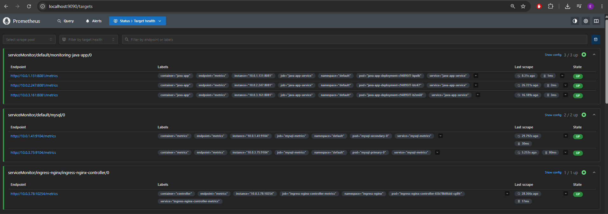
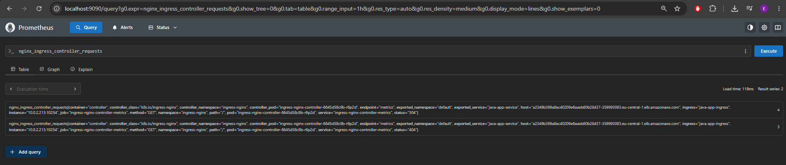
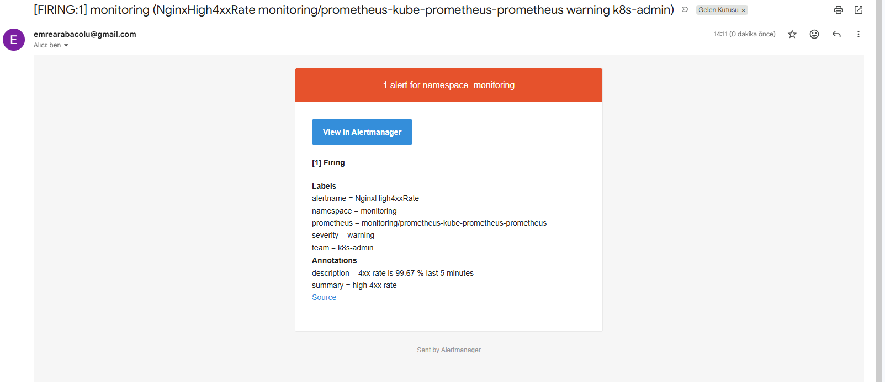
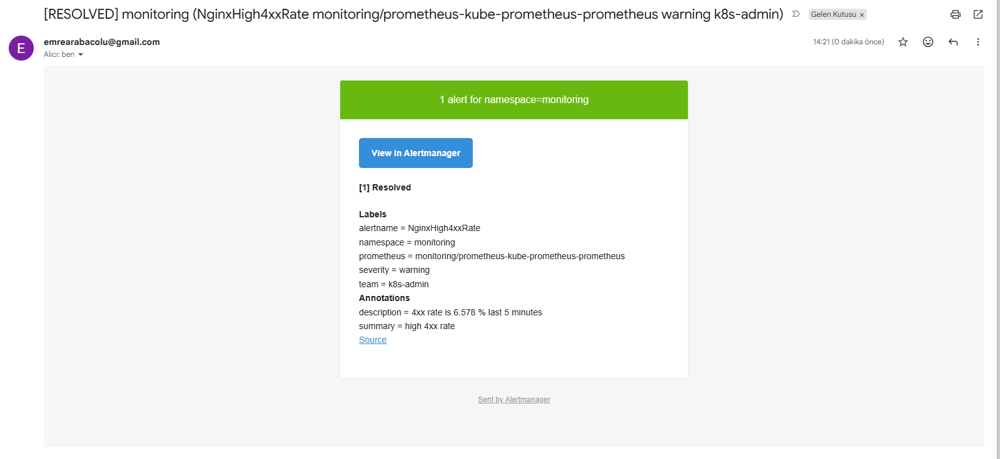
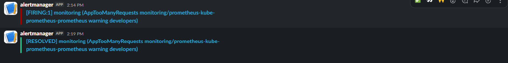

# Monitoring and alerting for a Java app with MySQL on EKS

**Technologies:** Prometheus, Alertmanager, Prometheus Operator (kube-prometheus-stack), kube-state-metrics, mysqld-exporter, Ansible (`kubernetes.core`, `community.docker`, `community.aws`), Terraform, AWS (EKS, VPC, ECR, EBS, Elastic Load Balancing), Kubernetes, Helm, ingress-nginx, Bitnami MySQL chart, Docker, Gradle, Java (Spring Boot), Slack, Gmail SMTP

A Java web app with a replicated MySQL behind an NGINX ingress on EKS, monitored with Prometheus. Prometheus scrapes the ingress controller, MySQL and the app itself, and five alert rules watch them: too many 4xx responses, MySQL down, too many MySQL connections, too many requests to the app, and StatefulSet replicas not ready. Alertmanager sends the app and database alerts to the developers' Slack channel and the ingress and Kubernetes alerts to the Kubernetes admin's email.

Terraform creates the cluster. Ansible does the rest: one playbook builds the app image and pushes it to ECR, another installs the monitoring stack, the alert rules, the Alertmanager config and the app, and a third removes everything again.

## How it works

```
terraform/                       VPC (3 public + 3 private subnets, NAT) + EKS (3 × t3.medium, EBS CSI driver)
        │
build-image-push-to-ecr.yaml     gradle build → ECR repo → docker login (ECR token) → build + push java-app:1.0
        │
deploy-to-cluster.yaml           kubeconfig ← terraform output
        │                        kube-prometheus-stack (Prometheus, Alertmanager, Operator, kube-state-metrics)
        │                        PrometheusRule alert-rules
        │                        Secret alertmanager-credentials ← $SLACK_WEBHOOK_URL, $SMTP_PASSWORD
        │                        AlertmanagerConfig (Slack + email)
        │                        ingress-nginx + metrics → AWS load balancer
        │                        DB Secret + ConfigMap → MySQL chart (primary + secondary) + mysqld-exporter
        │                        Java Deployment (3 pods) + Service + ServiceMonitor → Ingress
        │                        prints http://<load-balancer-dns>
        │
destroy.yaml                     ingress-nginx (load balancer) → MySQL chart → PVCs (EBS volumes)
                                 → terraform destroy → ECR repo
```

Inside the cluster:

```
browser ──> AWS load balancer ──> ingress-nginx ──> java-app-service :8080 ──> java-app (3 pods) ──> mysql-primary
                                                                                                    mysql-secondary

ingress-nginx       :10254 ─┐
mysqld-exporter     :9104  ├── ServiceMonitors ──> Prometheus ── alert-rules ──> Alertmanager
java-app            :8081  │                                                        ├ team=developers → Slack
kube-state-metrics  :8080 ─┘                                                        ├ team=k8s-admin  → Gmail
                                                                                    └ anything else   → null
```

| File | What it does |
|---|---|
| `terraform/` | VPC and EKS cluster: managed add-ons, EBS CSI driver with Pod Identity and a default StorageClass, node group of 3 `t3.medium` nodes. |
| `java-app/` | The Spring Boot app and its `Dockerfile` (`eclipse-temurin:17-jre`). The app serves on `8080` and exposes Prometheus metrics on `8081`: `java_app_http_requests_total` and `java_app_inprogress_requests`. |
| `build-image-push-to-ecr.yaml` | Builds the jar, creates the ECR repository, logs in to ECR and builds and pushes the image. |
| `deploy-to-cluster.yaml` | Writes the kubeconfig and installs everything in order: monitoring stack, alert rules, Alertmanager Secret and config, ingress-nginx, MySQL, Java app, Ingress. Waits for the load balancer and prints its address. |
| `destroy.yaml` | Removes ingress-nginx, the MySQL chart and its PVCs, runs `terraform destroy` and deletes the ECR repository. |
| `k8s/prometheus-values.yaml` | Lets Prometheus pick up every `ServiceMonitor` and `PrometheusRule` in the cluster and turns off the control plane targets that EKS does not expose. |
| `k8s/nginx-values.yaml` | Turns on the ingress-nginx metrics and its `ServiceMonitor`, and keeps request metrics for hosts that no Ingress names. |
| `k8s/mysql-values.yaml` | MySQL chart: replication (1 primary + 1 secondary), existing Secret, `mysqld-exporter` sidecar and its `ServiceMonitor`. |
| `k8s/java-app.yaml` | Java Deployment (3 replicas, image from ECR), Service with the ports `http` (8080) and `metrics` (8081), and a `ServiceMonitor` for `metrics`. |
| `k8s/java-app-ingress.yaml` | Routes `/` to `java-app-service` through the `nginx` ingress class. |
| `k8s/db-secret.yaml`, `k8s/db-config-chart.yaml` | DB credentials (also the keys the MySQL chart expects) and the connection settings (`DB_SERVER: mysql-primary`). |
| `k8s/alert-rules.yaml` | `PrometheusRule` with the five alert rules below. |
| `k8s/alertmanager-config.yaml` | `AlertmanagerConfig` with the Slack and email receivers and the routes by `team` label. |

### Alert rules

| Alert | Fires when | For | Team |
|---|---|---|---|
| `NginxHigh4xxRate` | More than 5% of the requests through the ingress in the last 5 minutes got a 4xx response | 2m | `k8s-admin` |
| `MysqlDown` | No MySQL instance is reachable, or no MySQL instance reports metrics at all | 1m | `developers` |
| `MysqlTooManyConnections` | A MySQL instance uses more than 80% of its `max_connections` | 1m | `developers` |
| `AppTooManyRequests` | The app gets more than 2 requests per second, summed over all pods | 1m | `developers` |
| `StatefulSetReplicasMismatch` | A StatefulSet has fewer or more ready replicas than it should | 1m | `k8s-admin` |

### Decisions

- **Scraping through the charts.** The ingress-nginx and MySQL charts can already expose metrics and create a `ServiceMonitor` for them, so no separate exporter is deployed. Only the Java app gets its own `ServiceMonitor`. It points to the Service port by its name `metrics`, so the scrape follows the port even if the number changes.
- **Prometheus reads every ServiceMonitor and PrometheusRule.** By default the chart's Prometheus only loads resources with its own Helm release label. With `serviceMonitorSelectorNilUsesHelmValues` and `ruleSelectorNilUsesHelmValues` set to `false`, the files here need no extra labels.
- **One metrics library in the app.** The counters and the metrics HTTP server must use the same Prometheus client library. With the old `simpleclient` for the counters and the new `prometheus-metrics` 1.x server, the counters went to a registry the server never read and `/metrics` was empty. Everything is on `prometheus-metrics` 1.x now.
- **Request metrics without a host.** The Ingress has no `host`, so the app is reached by the load balancer's DNS name. By default ingress-nginx only keeps per-request metrics for hosts named in an Ingress, so `nginx_ingress_controller_requests` stayed empty. `--metrics-per-undefined-host=true` keeps them.
- **Ratios over sums, limits per instance.** The 4xx rate and the request rate are sums over all pods, because the Service spreads requests over them and one pod alone shows only part of the load. The MySQL connection limit belongs to each instance, so that rule compares each instance with its own limit and the alert names the pod.
- **MySQL down also means no metrics.** `mysql_up` comes from the exporter in the MySQL pod. If the MySQL container fails, the exporter reports `0`. If the pod itself is gone, the metric disappears. `absent(mysql_up)` covers the second case.
- **Routing by label, not by alert name.** Every rule carries a `team` label, and Alertmanager routes by it. A new rule only needs the right label, the Alertmanager config stays the same. Alerts without a `team` label, like the chart's built-in rules, go to the empty `null` receiver.
- **`namespace: monitoring` on every rule.** The Operator adds a `namespace="monitoring"` matcher to all routes of an `AlertmanagerConfig` in the `monitoring` namespace. The rules set this label so their alerts match.
- **No secrets in the repository.** The Slack webhook URL and the Gmail App Password are read from environment variables when the playbook runs and stored only in the `alertmanager-credentials` Secret in the cluster. The task has `no_log: true`, so Ansible doesn't print them. The `AlertmanagerConfig` refers to the Secret by name and key.
- **Resolved notifications.** `sendResolved: true` sends a second message when an alert stops firing.
- **Destroy cleans up what Terraform doesn't know.** The load balancer of ingress-nginx and the EBS volumes of the MySQL PVCs are created by Kubernetes, not by Terraform. They are deleted first, with a pause for AWS to finish, so `terraform destroy` can remove the VPC. The monitoring stack creates neither, so it goes with the cluster.

## Requirements

- Terraform, AWS CLI, `kubectl`, Docker, Gradle
- Ansible with the `kubernetes.core`, `community.docker` and `community.aws` collections, and `boto3`, `botocore` and `kubernetes` in the same Python environment
- AWS credentials with permissions for EC2, EKS, IAM, ECR and Elastic Load Balancing
- A Slack Incoming Webhook URL for the developers' channel
- A Gmail account with 2-step verification and an App Password. The email addresses are set in `k8s/alertmanager-config.yaml`.

## Usage

```bash
# 1. Cluster
terraform -chdir=terraform init
terraform -chdir=terraform apply -var-file=environments/dev.tfvars

# 2. Image
ansible-playbook build-image-push-to-ecr.yaml

# 3. Notification credentials, typed in and not saved in the shell history
read -rs SLACK_WEBHOOK_URL && export SLACK_WEBHOOK_URL
read -rs SMTP_PASSWORD && export SMTP_PASSWORD

# 4. Monitoring stack, alerting and app (prints the app URL at the end)
ansible-playbook deploy-to-cluster.yaml

# 5. Delete everything
ansible-playbook destroy.yaml
```

Prometheus and Alertmanager are not exposed outside the cluster. Open them with a port-forward:

```bash
kubectl port-forward svc/prometheus-kube-prometheus-prometheus 9090:9090 -n monitoring      # http://localhost:9090
kubectl port-forward svc/prometheus-kube-prometheus-alertmanager 9093:9093 -n monitoring    # http://localhost:9093
```

## Testing

Two alerts were triggered on purpose, one for each channel:

```bash
# NginxHigh4xxRate → email: requests to a path that doesn't exist (404)
while true; do curl -s -o /dev/null http://<load-balancer-dns>/path-that-does-not-exist; sleep 0.5; done

# AppTooManyRequests → Slack: requests to the app's /get-data endpoint as fast as possible
while true; do curl -s -o /dev/null http://<load-balancer-dns>/get-data; done
```

Each loop ran until the alert was `Firing` in Prometheus and the notification arrived, then it was stopped with `Ctrl+C` to get the resolved notification.

## Result

- Deploy finished with `failed=0`. All targets were `up`: 3/3 Java pods on `8081`, 2/2 MySQL exporters on `9104`, 1/1 ingress-nginx controller on `10254`.

  

- `nginx_ingress_controller_requests` split the requests through `java-app-ingress` by status code, here `304` from the app page and `404` from a path that doesn't exist.

  

- `NginxHigh4xxRate` fired with a 4xx rate of 99.67% and the email arrived with the `team = k8s-admin` label. When the 404 loop stopped, the resolved email followed.

  
  

- `AppTooManyRequests` fired with the `developers` label and arrived in Slack, followed by the resolved message 5 minutes later.

  

- Destroy finished with `failed=0`. Afterwards the account had 0 EKS clusters, 0 Classic load balancers, 0 ALB/NLB load balancers and 0 unattached EBS volumes in `eu-central-1`.
